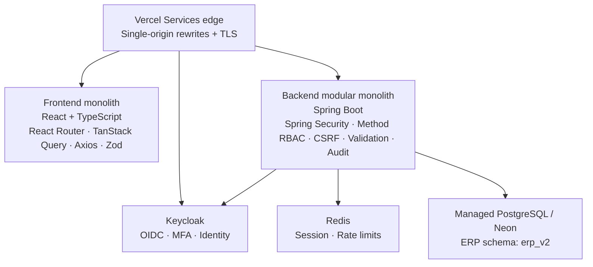

# Target architecture: two independent monoliths



Frontend và backend là hai đơn vị build/deploy độc lập. Mỗi bên là một monolith duy nhất; module là ranh giới mã nguồn trong cùng tiến trình, không giao tiếp qua message broker hoặc HTTP nội bộ.

## Frontend monolith

```text
apps/frontend/src
├── app/                 composition root và router
├── core/
│   ├── domain/          contract dùng chung
│   └── http/            Axios, CSRF và xử lý lỗi phiên
├── features/
│   ├── auth/            login, session và protected route
│   ├── dashboard/       tổng quan vận hành
│   └── modules/         màn hình module nghiệp vụ
├── layout/              application shell và menu theo quyền
├── test/                test bootstrap
└── main.tsx             entrypoint duy nhất
```

Feature có thể dùng `core` và `layout`; `core` không được import ngược feature. TanStack Query cache dùng chung được xóa khi logout hoặc phiên hết hạn.

## Backend modular monolith

```text
apps/backend/src/main/java/com/company/erp
├── identity/            OIDC identity, current user, company list
├── company/             company scope authorization
├── dashboard/           module summary use case/API
├── audit/               immutable security/business audit
├── hr/                  HR workflows và dữ liệu nhạy cảm mã hóa
├── platform/
│   ├── security/        Spring Security, CSRF, role mapping, rate limit
│   └── web/             safe global API error handling
└── ErpApplication.java  composition root duy nhất
```

Các domain chạy trong cùng một Spring ApplicationContext, cùng transaction manager và cùng PostgreSQL schema `erp_v2`. Controller chỉ gọi application service của domain; quyền dữ liệu được kiểm tra bằng Method Security trước khi truy vấn.

## Authentication flow

The browser starts login at `/oauth2/authorization/keycloak`. Spring Boot performs Authorization Code + PKCE with Keycloak and stores the authenticated server session in Redis. The browser receives only the `ERP_SESSION` HttpOnly cookie. Mutations require the `XSRF-TOKEN` cookie echoed as `X-XSRF-TOKEN`; Axios handles this after `/api/v1/auth/csrf` materializes the token.

Keycloak roles map to Spring authorities. Method security checks both the requested permission and company membership; frontend menu filtering is never authoritative.

## Network boundaries

Vercel Services is the production edge. Rewrites expose the frontend monolith, `/api`, OAuth callback and Keycloak routes on one origin. Spring and Keycloak communicate through an internal service binding; PostgreSQL and Redis remain managed dependencies. For local/self-hosted operation, Nginx provides the same single-origin routing and the Compose `data` network stays internal.

## Data migration

Flyway owns the isolated PostgreSQL schema `erp_v2`, while Keycloak uses its own tables in the same managed database. The previous Prisma tables remain untouched for rollback and data reconciliation. Any later ETL migration must compare row counts and financial/inventory totals before legacy data is retired.
