# Logical ERD

Sơ đồ này thể hiện ownership và liên kết chính, không thay thế DDL Flyway.

```mermaid
erDiagram
  COMPANY ||--o{ COMPANY_MEMBERSHIP : has
  ERP_USER ||--o{ COMPANY_MEMBERSHIP : joins
  COMPANY_MEMBERSHIP ||--o{ COMPANY_MEMBERSHIP_ROLE : receives
  COMPANY_ROLE ||--o{ COMPANY_MEMBERSHIP_ROLE : assigned_as
  COMPANY_ROLE ||--o{ COMPANY_ROLE_PERMISSION : grants
  COMPANY_MEMBERSHIP ||--o{ COMPANY_MEMBERSHIP_SCOPE : limited_by
  COMPANY ||--o{ COMPANY_BRANCH : operates
  COMPANY ||--o{ DEPARTMENT : organizes
  COMPANY_BRANCH ||--o{ DEPARTMENT : contains
  DEPARTMENT ||--o{ DEPARTMENT : reports_to
  DEPARTMENT ||--o{ JOB_POSITION : defines
  JOB_POSITION ||--o{ JOB_POSITION : reports_to
  COMPANY ||--o{ EMPLOYEE : employs
  DEPARTMENT ||--o{ EMPLOYEE : groups
  EMPLOYEE ||--o| EMPLOYEE_PRIVATE_PROFILE : protects
  EMPLOYEE ||--o{ EMPLOYEE_DOCUMENT : owns
  COMPANY ||--o{ RECRUITMENT_POSITION : recruits
  RECRUITMENT_POSITION ||--o{ RECRUITMENT_CANDIDATE : receives
  EMPLOYEE ||--o{ ATTENDANCE_ENTRY : records
  EMPLOYEE ||--o{ LEAVE_REQUEST : requests
  EMPLOYEE ||--o{ PAYSLIP : receives
  COMPANY ||--o{ PM_PROJECT : runs
  PM_PROJECT ||--o{ PM_PROJECT_MEMBER : staffs
  PM_PROJECT ||--o{ PM_SPRINT : plans
  PM_PROJECT ||--o{ PM_TASK : contains
  PM_TASK ||--o{ PM_TASK_COMMENT : discusses
  PM_TASK ||--o{ PM_TASK_CHECKLIST_ITEM : checks
  PM_TASK ||--o{ PM_TIMESHEET : logs
  COMPANY ||--o{ PM_ISSUE : tracks
  COMPANY ||--o{ CUSTOMER : serves
  CUSTOMER ||--o{ CRM_CONTACT : has
  CUSTOMER ||--o{ CRM_INTERACTION : records
  COMPANY ||--o{ CRM_LEAD : captures
  CRM_CAMPAIGN ||--o{ CRM_LEAD : generates
  CUSTOMER ||--o{ CRM_OPPORTUNITY : develops
  CRM_PIPELINE_STAGE ||--o{ CRM_OPPORTUNITY : classifies
  CRM_OPPORTUNITY ||--o{ CRM_QUOTE : proposes
  CUSTOMER ||--o{ CRM_CONTRACT : signs
  CRM_CONTRACT ||--o{ CRM_CONTRACT_PAYMENT : schedules
  CUSTOMER ||--o{ CRM_SALES_ORDER : orders
  CRM_SALES_ORDER ||--o{ CRM_SALES_RETURN : returns
  CUSTOMER ||--o{ CRM_SUPPORT_TICKET : requests
  COMPANY ||--o{ FINANCE_BUDGET : plans
  DEPARTMENT ||--o{ FINANCE_BUDGET : owns
  PM_PROJECT ||--o{ FINANCE_BUDGET : limits
  COMPANY ||--o{ FINANCE_CASH_TRANSACTION : records
  CUSTOMER ||--o{ FINANCE_INVOICE : owes
  SUPPLIER ||--o{ FINANCE_INVOICE : bills
  FINANCE_INVOICE ||--o{ FINANCE_INVOICE_PAYMENT : receives
  EMPLOYEE ||--o{ FINANCE_ADVANCE : requests
  FINANCE_ADVANCE ||--o{ FINANCE_ADVANCE_EXPENSE : settles
  PM_PROJECT ||--o{ FINANCE_PROJECT_COST : incurs
  COMPANY ||--o{ FINANCE_ACCOUNT : defines
  COMPANY ||--o{ FINANCE_JOURNAL : posts
  FINANCE_JOURNAL ||--o{ FINANCE_JOURNAL_LINE : contains
  FINANCE_ACCOUNT ||--o{ FINANCE_JOURNAL_LINE : classifies
  COMPANY ||--o{ STORE : owns
  STORE ||--o{ PRODUCT : sells
  PRODUCT ||--o{ VARIANT : varies
  WAREHOUSE ||--o{ INVENTORY_LEVEL : stores
  VARIANT ||--o{ INVENTORY_LEVEL : stocked_as
  STORE ||--o{ ORDER : receives
  COMPANY ||--o{ SUPPLIER : sources
  SUPPLIER ||--o{ PURCHASE_ORDER : fulfills
  COMPANY ||--o{ PURCHASE_REQUEST : requests
  FINANCE_BUDGET ||--o{ PURCHASE_REQUEST : funds
  PURCHASE_REQUEST ||--o{ OPS_PURCHASE_REQUEST_ITEM : contains
  PURCHASE_REQUEST ||--o{ PURCHASE_ORDER : converts_to
  PURCHASE_ORDER ||--o{ OPS_PURCHASE_ORDER_ITEM : contains
  PURCHASE_ORDER ||--o{ OPS_GOODS_RECEIPT : receives
  WAREHOUSE ||--o{ OPS_GOODS_RECEIPT : accepts
  COMPANY ||--o{ OPS_INVENTORY_ITEM : catalogs
  OPS_INVENTORY_ITEM ||--o{ OPS_STOCK_LEVEL : stocked_as
  WAREHOUSE ||--o{ OPS_STOCK_LEVEL : stores
  OPS_INVENTORY_ITEM ||--o{ OPS_STOCK_MOVEMENT : moves
  WAREHOUSE ||--o{ OPS_STOCK_COUNT : counts
  COMPANY ||--o{ OPS_ASSET : owns
  EMPLOYEE ||--o{ OPS_ASSET_ASSIGNMENT : receives
  OPS_ASSET ||--o{ OPS_ASSET_ASSIGNMENT : assigned_with
  OPS_ASSET ||--o{ OPS_MAINTENANCE_ORDER : maintained_by
  COMPANY ||--o{ OPS_SOFTWARE_LICENSE : licenses
  OPS_INVENTORY_ITEM ||--o{ OPS_MANUFACTURING_ORDER : produces
  COMPANY ||--o{ OPS_SHIPMENT : transports
  COMPANY ||--o{ WORKPLACE_FOLDER : organizes
  WORKPLACE_FOLDER ||--o{ WORKPLACE_DOCUMENT : contains
  WORKPLACE_DOCUMENT ||--o{ WORKPLACE_DOCUMENT_VERSION : versions
  WORKPLACE_DOCUMENT ||--o{ WORKPLACE_DOCUMENT_ACCESS : shares
  COMPANY ||--o{ WORKPLACE_KB_SPACE : curates
  WORKPLACE_KB_SPACE ||--o{ WORKPLACE_KB_ARTICLE : publishes
  COMPANY ||--o{ WORKPLACE_APPROVAL_REQUEST : requests
  WORKPLACE_APPROVAL_REQUEST ||--o{ WORKPLACE_APPROVAL_STEP : routes
  WORKPLACE_FORM_DEFINITION ||--o{ WORKPLACE_FORM_SUBMISSION : receives
  WORKPLACE_DOCUMENT ||--o{ WORKPLACE_SIGNATURE_REQUEST : confirms
  WORKPLACE_SIGNATURE_REQUEST ||--o{ WORKPLACE_SIGNATURE_RECIPIENT : routes
  COMPANY ||--o{ WORKPLACE_HELPDESK_TICKET : supports
  WORKPLACE_HELPDESK_TICKET ||--o{ WORKPLACE_HELPDESK_COMMENT : discusses
  COMPANY ||--o{ WORKPLACE_CHANNEL : communicates
  WORKPLACE_CHANNEL ||--o{ WORKPLACE_MESSAGE : contains
  WORKPLACE_DOCUMENT ||--o{ WORKPLACE_LEGAL_RECORD : evidences
  WORKPLACE_LEGAL_RECORD ||--o{ WORKPLACE_LEGAL_OBLIGATION : requires
  COMPANY ||--o{ PLATFORM_NOTIFICATION : sends
  COMPANY ||--o{ PLATFORM_NOTIFICATION_PREFERENCE : configures
  COMPANY ||--o{ PLATFORM_SAVED_VIEW : stores
  COMPANY ||--o{ AUDIT_LOG : records
  COMPANY ||--o{ INTEGRATION_CONNECTION : configures
  INTEGRATION_CONNECTION ||--o{ INTEGRATION_WEBHOOK_ENDPOINT : exposes
  COMPANY ||--o{ AUTOMATION_WORKFLOW : owns
  AUTOMATION_WORKFLOW ||--o{ AUTOMATION_STEP : contains
  AUTOMATION_WORKFLOW ||--o{ AUTOMATION_RUN : executes
  AUTOMATION_RUN ||--o{ AUTOMATION_RUN_STEP : traces
  INTEGRATION_WEBHOOK_ENDPOINT ||--o{ INTEGRATION_WEBHOOK_DELIVERY : queues
  AUTOMATION_RUN ||--o{ INTEGRATION_WEBHOOK_DELIVERY : emits
  COMPANY ||--o{ STRATEGIC_OBJECTIVE : defines
  STRATEGIC_OBJECTIVE ||--o{ STRATEGIC_KEY_RESULT : measures
  COMPANY ||--o{ MANAGEMENT_REPORT_SNAPSHOT : preserves
```

Mọi aggregate nghiệp vụ thuộc đúng một company; dữ liệu nhạy cảm HR tách khỏi hồ sơ cơ bản; audit là append-only; Redis và read model phải có thể dựng lại từ PostgreSQL hoặc event history.
